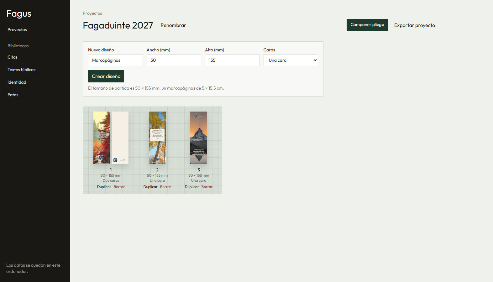
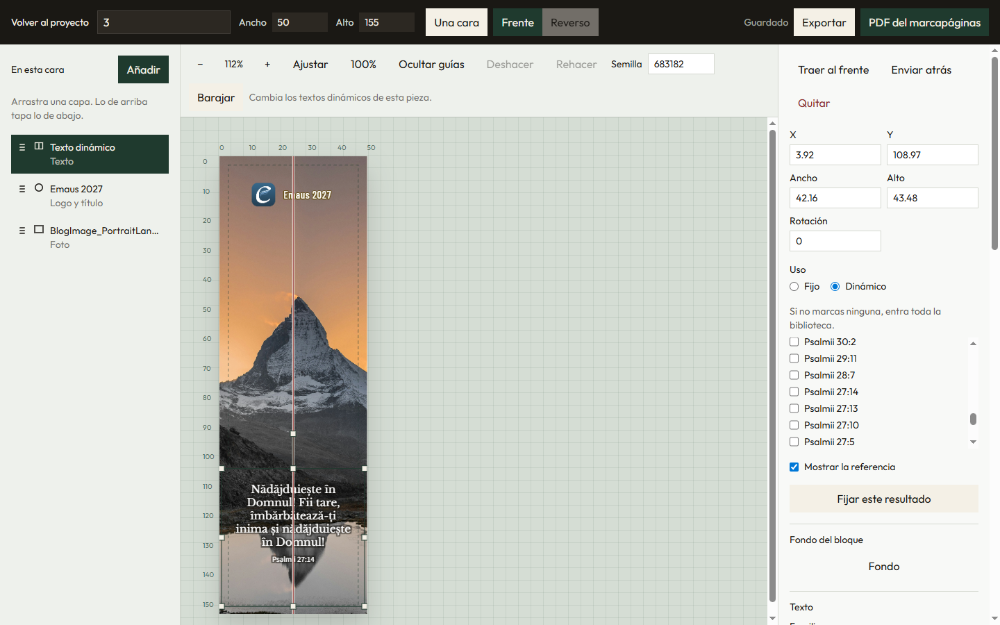
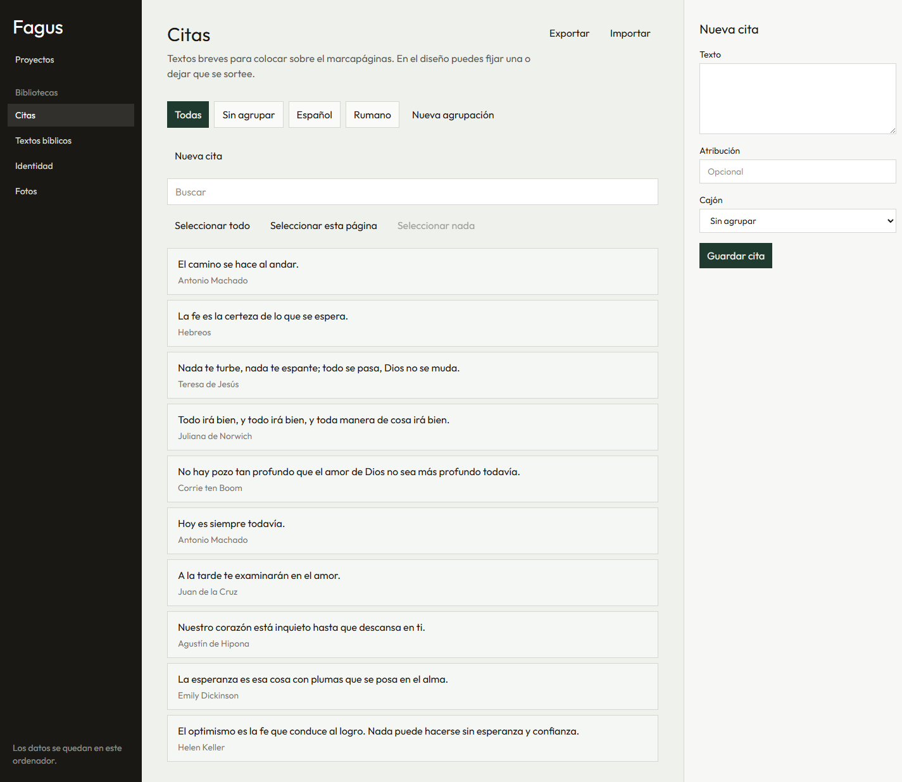
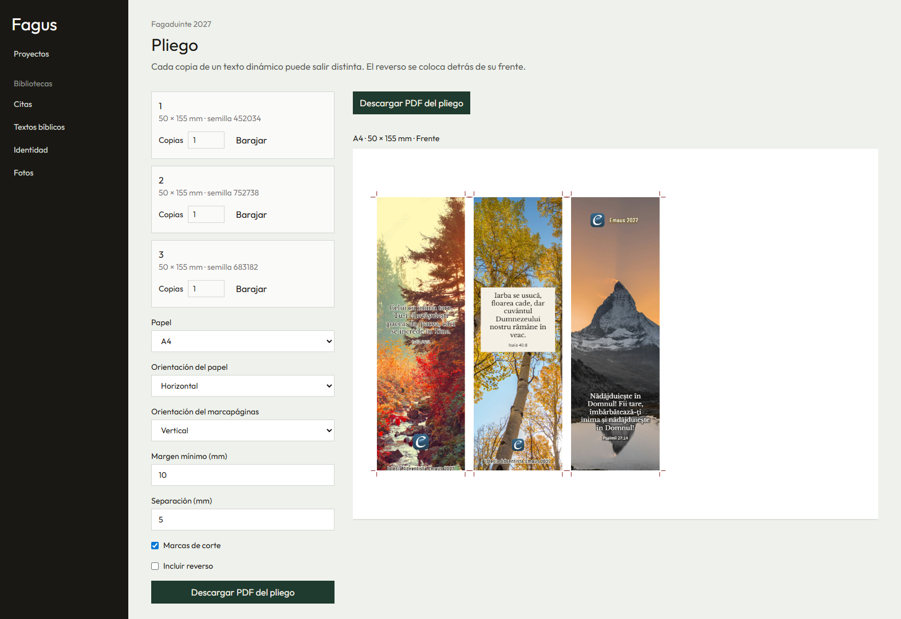

# Fagus

Estudio local para diseñar marcapáginas. Los proyectos, las fotos y los textos se guardan en un SQLite de esta máquina (`data/fagus.db`). No hay cuenta ni servidor remoto.

## Arranque

Requiere Node 22 o superior y pnpm.

```bash
pnpm install
pnpm dev
```

Abre http://localhost:5173. Para una copia ya compilada:

```bash
pnpm start
```

## Despliegue

En un VPS, con Docker o Dokploy: [instrucciones de despliegue](docs/docker.md).

## Qué puedes hacer

### Proyectos

Cada proyecto reúne los marcapáginas de un encargo. El tamaño de partida es 50 × 155 mm (5 × 15,5 cm), a una o dos caras. Desde aquí se abre el editor, se duplica un diseño, se exporta el archivo `.fagus` o se pasa a componer el pliego.



### Editor

En el editor se encaja una foto, la identidad de la iglesia (un título corto o un logo) y un texto. El texto puede quedar fijo o salir de la biblioteca: Barajar cambia el resultado y Fijar este resultado lo deja quieto. La semilla se guarda con el diseño. Cada cara se exporta en PNG o en un PDF a tamaño real.



### Bibliotecas

Las citas, los textos bíblicos, las identidades y las fotos viven aparte del proyecto y se reutilizan en cualquier diseño. Se pueden agrupar, buscar, e importar o exportar.



### Pliego

Para imprimir se indica cuántas copias de cada diseño, el papel (A4 o A3), la orientación y si se dibujan marcas de corte. En doble cara, el reverso se coloca volteando por el borde largo o el corto, sin espejar el dibujo. Cada copia de un texto dinámico puede salir distinta.



## Pruebas

```bash
pnpm test
```
